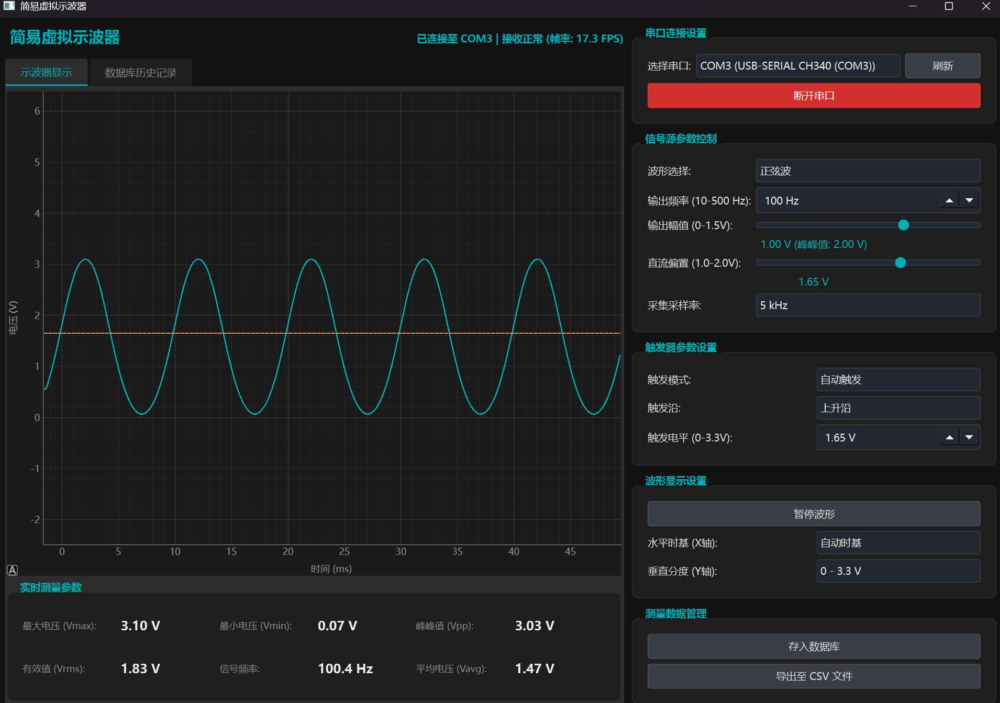
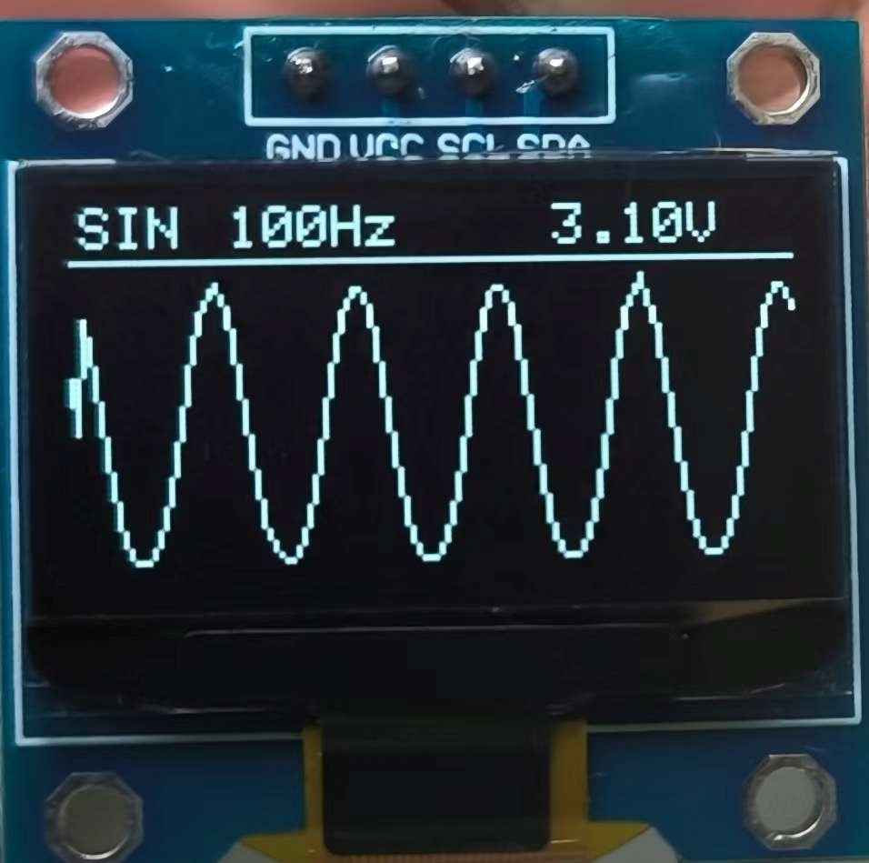
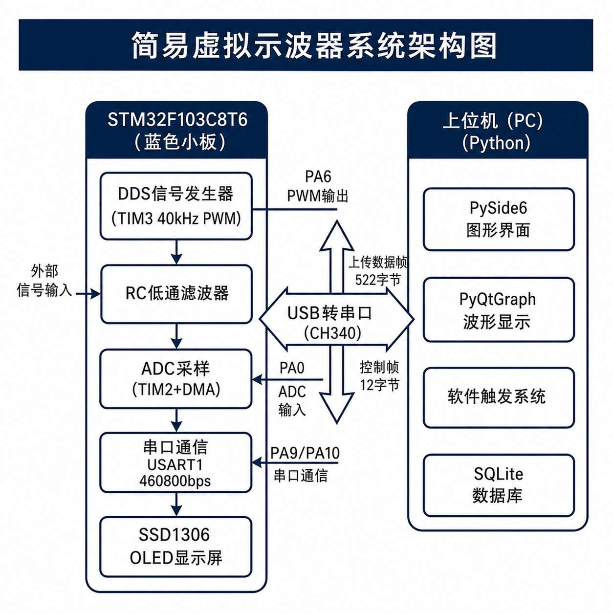
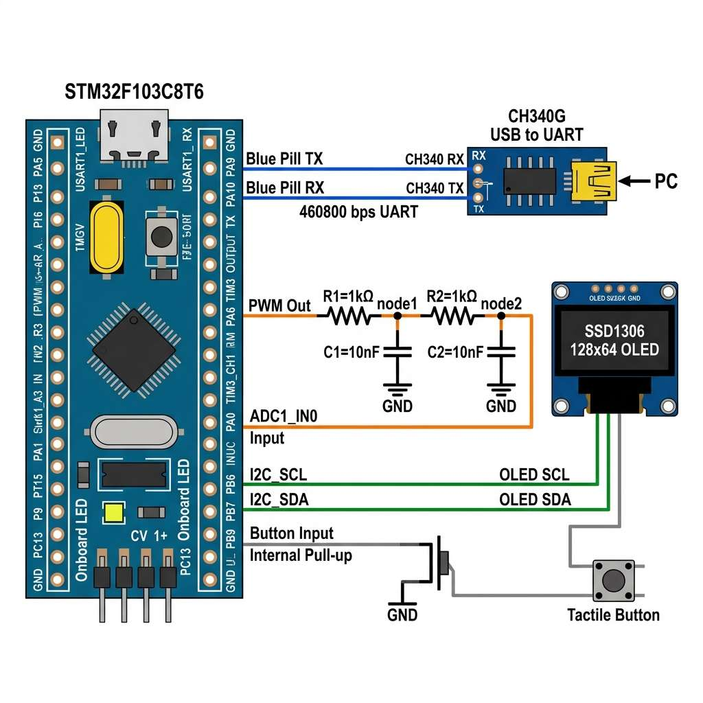
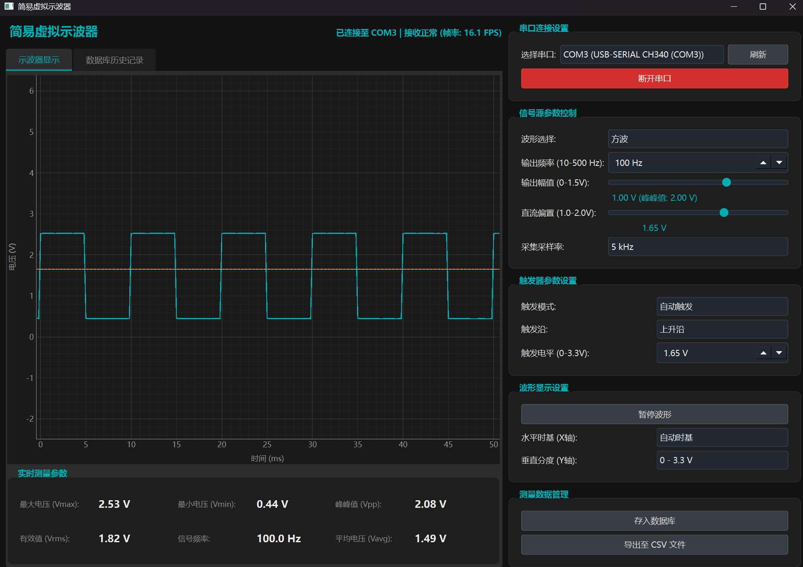
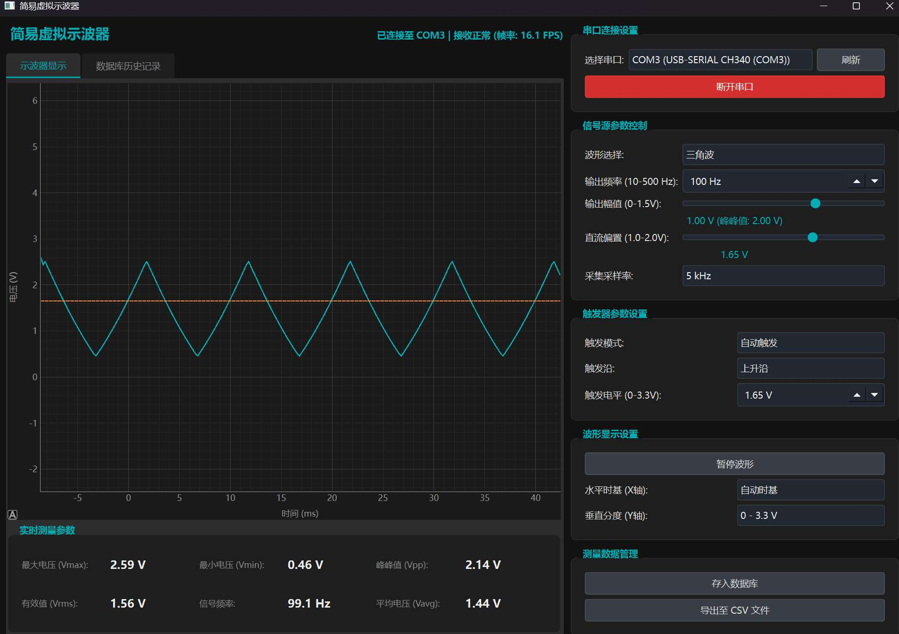
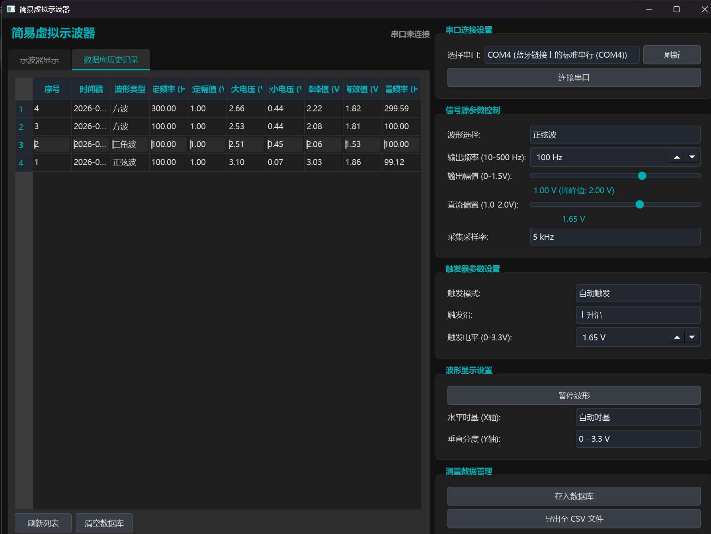

# 基于 STM32F103C8T6 的简易虚拟示波器

> 主控 STM32F103C8T6 (Blue Pill) · 下位机 Arduino + PlatformIO · 上位机 Python + PySide6

<p align="center">
  
</p>
<p align="center">
  
</p>

## 一、项目简介

本项目实现了一个完整的"信号发生器 + 数据采集器 + 上位机虚拟示波器"闭环系统。STM32F103C8T6 通过 PWM + RC 低通滤波产生正弦波、方波、三角波测试信号，同时经 ADC 采集波形数据，通过串口上传至电脑端 Python 上位机实时显示。

### 功能特性

- **DDS 信号发生器**：正弦波 / 方波 / 三角波，频率、幅值、偏置可调
- **ADC 数据采集**：12 位精度，采样率 5 / 10 / 20 kHz 可调
- **OLED 本地显示**：SSD1306 128×64，实时显示波形和参数
- **上位机软件**：PySide6 GUI，实时波形、参数控制、自动测量、CSV 导出、SQLite 历史记录
- **物理按钮切换**：PB9 按键切换波形类型

## 二、系统架构

<p align="center">
  
</p>

下位机（STM32F103C8T6）负责 DDS 波形生成与 ADC 采集，经两级 RC 滤波完成信号回环；
上位机（Python + PySide6）负责实时波形显示、参数下发、自动测量与 SQLite 存储，
两者通过串口自定义二进制帧协议通信。

## 三、硬件方案

### 3.1 引脚分配

| 功能 | 引脚 | 外设 | 说明 |
|------|------|------|------|
| PWM 波形输出 | PA6 | TIM3_CH1 | 40kHz 载波，~10.8 位分辨率 |
| ADC 信号采集 | PA0 | ADC1_IN0 | 12 位 (0~4095) |
| 串口通信 | PA9 / PA10 | USART1 TX/RX | 460800 bps |
| OLED 显示 | PB6 / PB7 | I2C1 SCL/SDA | SSD1306 128×64 |
| 波形切换按钮 | PB9 | GPIO | 按键切换正弦/方波/三角 |
| 板载 LED | PC13 | GPIO | 低电平点亮 |

### 3.2 接线方式

**信号回环（核心连接）**：

<p align="center">
  
</p>

```
PA6 (PWM) ──[R1=1kΩ]──┬── PA0 (ADC)
                      │
                   [C1=10nF]
                      │
                     GND
```

**串口连接**：

```
STM32              USB转串口模块
PA9  (TX) ───────→ RXD
PA10 (RX) ←─────── TXD
GND       ─────── GND    (必须共地)
```

**OLED 连接**：

```
STM32              SSD1306 OLED
PB6 (SCL) ─────── SCL
PB7 (SDA) ─────── SDA
3.3V      ─────── VCC
GND       ─────── GND
```

### 3.3 所需材料

| 材料 | 数量 | 说明 |
|------|------|------|
| STM32F103C8T6 最小系统板 | 1 | Blue Pill，淘宝约 10 元 |
| USB 转 TTL 串口模块 | 1 | CH340 或 CP2102 |
| SSD1306 OLED 0.96寸 | 1 | I2C 接口，128×64 |
| 电阻 1kΩ | 2 | 两级 RC 滤波 |
| 电容 10nF | 2 | 两级 RC 滤波（C1、C2） |
| 杜邦线 | 若干 | 至少 8 根 |
| ST-Link V2（可选） | 1 | 烧录调试，也可用串口烧录 |

## 四、通信协议

### 4.1 MCU → PC 数据帧（UploadFrame）

| 字段 | 长度 | 值 | 说明 |
|------|------|-----|------|
| 帧头 | 2 字节 | `0xAA 0x55` | 固定标志 |
| 波形类型 | 1 字节 | 0/1/2 | 正弦/方波/三角 |
| 采样率 | 4 字节 | uint32 | 小端序，单位 Hz |
| 采样点数 | 2 字节 | uint16 | 固定 256 |
| 数据区 | 512 字节 | uint16[256] | ADC 值 0~4095，小端序 |
| 校验 | 1 字节 | uint8 | 前述字段累加和低 8 位 |

总帧长：522 字节

### 4.2 PC → MCU 控制帧（ControlFrame）

| 字段 | 长度 | 值 | 说明 |
|------|------|-----|------|
| 帧头 | 2 字节 | `0x55 0xAA` | 固定标志 |
| 波形类型 | 1 字节 | 0/1/2 | 正弦/方波/三角 |
| 频率 | 2 字节 | uint16 | 目标频率 Hz |
| 幅值 | 2 字节 | uint16 | 目标幅值 mV (0~1500) |
| 偏置 | 2 字节 | uint16 | 直流偏置 mV (1000~2000) |
| 采样率 | 2 字节 | uint16 | 5000/10000/20000 |
| 校验 | 1 字节 | uint8 | 前述字段累加和低 8 位 |

总帧长：12 字节

## 五、技术参数

| 参数 | 数值 | 说明 |
|------|------|------|
| MCU | STM32F103C8T6 | 72MHz, 64KB Flash, 20KB RAM |
| DAC 方案 | PWM + RC 滤波 | C8T6 无片上 DAC |
| PWM 载波频率 | 40 kHz | 72MHz / (1799+1) |
| PWM 有效分辨率 | ~10.8 位 | log₂(1800) |
| RC 滤波截止频率 | ~16 kHz | 1/(2π×1kΩ×10nF) |
| ADC 精度 | 12 位 | 0~4095, 对应 0~3.3V |
| 采样率 | 5 / 10 / 20 kHz | 可调 |
| 数据帧大小 | 256 样本/帧 | 522 字节/帧 |
| 串口波特率 | 460800 bps | |
| OLED 刷新 | ~10 fps | 非阻塞更新 |

## 六、效果展示

| 方波（上位机） | 三角波（上位机） | 数据库历史记录 |
|----------------|------------------|----------------|
|  |  |  |

## 七、快速开始

### 6.1 下位机编译烧录

1. 安装 [VSCode](https://code.visualstudio.com/) + [PlatformIO IDE 插件](https://platformio.org/)
2. 用 VSCode 打开 `firmware/` 目录
3. PlatformIO 会自动下载依赖库（DdsOscillator、Adafruit SSD1306、Adafruit GFX）
4. 连接 ST-Link 或 USB 转串口模块到 Blue Pill
5. 编译并烧录：

```bash
pio run --target upload
```

> **串口烧录**：若无 ST-Link，可将 BOOT0 接 3.3V，修改 `platformio.ini` 中 `upload_protocol = serial`，设置 `upload_port = COMx`，执行烧录后将 BOOT0 接回 GND。

### 6.2 上位机运行

```bash
cd pc_app
pip install -r requirements.txt
python oscilloscope_pc.py
```

在软件中选择对应 COM 端口，点击"连接设备"，再点击"开始"即可看到实时波形。

### 6.3 系统联调

1. 烧录固件后，OLED 显示波形网格和参数
2. 上位机连接串口后，实时显示采集波形
3. 上位机可调节波形类型、频率、幅值、偏置、采样率
4. 按 PB9 按钮切换正弦波 / 方波 / 三角波
5. 支持保存数据为 CSV，历史记录存入 SQLite

## 八、项目结构

```
VirtualOscilloscope/
├── firmware/                      # STM32 下位机固件
│   ├── platformio.ini             # PlatformIO 构建配置
│   └── src/
│       ├── main.cpp               # 主程序
│       └── DdsWaveformGenerator.h # DDS 波形生成器
│
├── pc_app/                        # Python 上位机
│   ├── oscilloscope_pc.py         # 主程序 (PySide6 GUI)
│   └── requirements.txt           # Python 依赖
│
├── docs/
│   ├── images/                     # 效果截图与原理图
│   └── 硬件连接与烧录指南.md       # 详细接线与烧录教程
│
├── .gitignore
└── README.md
```

## 九、依赖清单

### 下位机（PlatformIO lib_deps 自动安装）

| 库 | 版本 | 用途 |
|----|------|------|
| aynka/DdsOscillator | ^1.0.0 | DDS 振荡器 |
| adafruit/Adafruit SSD1306 | ^2.5.9 | OLED 显示驱动 |
| adafruit/Adafruit GFX Library | ^1.11.9 | 图形库 |

### 上位机

| 包 | 版本 | 用途 |
|----|------|------|
| PySide6 | >= 6.5.0 | GUI 框架 |
| pyqtgraph | >= 0.13.0 | 实时波形绘图 |
| numpy | >= 1.24.0 | 数据处理 |
| pyserial | >= 3.5 | 串口通信 |

## 十、安全注意事项

- ⚠️ ADC 输入只允许 0~3.3V，严禁接入更高电压或市电
- ⚠️ 环回连接必须串联限流电阻，不可将 PA6 直连 PA0
- ⚠️ 信号地与开发板地必须正确连接
- ⚠️ 调试时先低频低采样率运行，确认无误后再逐步提高

## 十一、许可

本项目采用 [MIT License](LICENSE) 发布。
